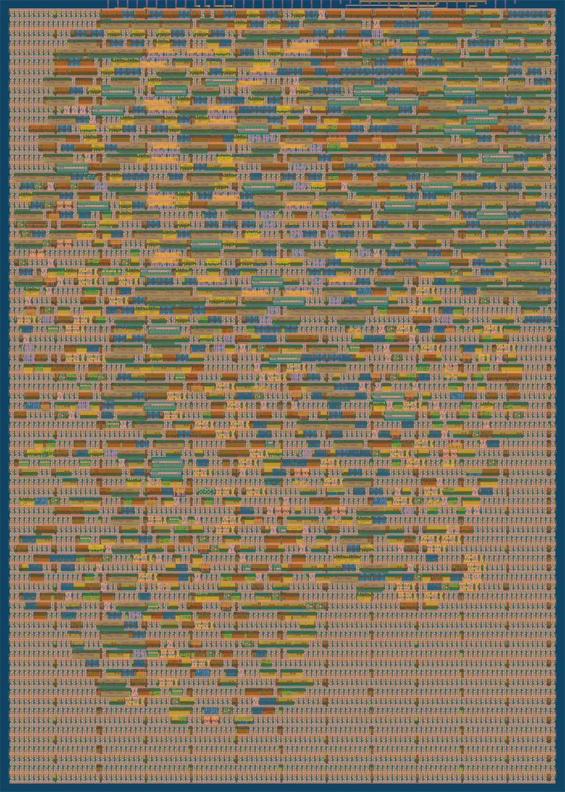

<p align="center">
  <picture>
    <source media="(prefers-color-scheme: dark)" srcset="docs/img/mantis-logo-dark.webp">
    <source media="(prefers-color-scheme: light)" srcset="docs/img/mantis-logo-light.webp">
    
  </picture>
</p>

# MANTIS: a $2 \times 2$ FP8 matrix multiplier for Tiny Tapeout

MANTIS (`tt_um_lucas_rigsby_mantis`) multiplies a $2 \times K$ matrix by a $K \times 2$ matrix of 8-bit
floating-point values and accumulates the result in BF16. The design targets
two Tiny Tapeout tiles on Sky130 at 50 MHz. The host writes one byte per
clock, and the datapath performs one exact multiply-accumulate per clock.

This README covers the design and how to run it, then describes how the
architecture was chosen. The JTAG test port, which is a stretch goal, is
described at the end.

- [Overview](#overview)
- [Getting started](#getting-started)
- [Repository layout](#repository-layout)
- [Design process](#design-process)
- [Stretch goal: JTAG](#stretch-goal-jtag)

---

## Overview

### Function

For $A \in \mathbb{F}^{2 \times K}$ and $B \in \mathbb{F}^{K \times 2}$,
MANTIS computes $C = AB$ with four BF16 accumulators. Each accumulator is
updated once per reduction index $k$ and rounded at every step:

```math
C_{ij}^{(k+1)} = \mathrm{RNE}_{\mathrm{BF16}}\left( C_{ij}^{(k)} + A_{ik} \, B_{kj} \right),
\qquad C_{ij}^{(0)} = +0, \qquad k = 0, 1, \ldots, K-1 .
```

- Inputs are OCP FP8 in E4M3FN or E5M2 format, selected independently for
  A and B. Subnormal inputs and special values are decoded as the formats
  define them.
- Each product $A_{ik} B_{kj}$ is formed exactly. An FP8 product has at most
  8 significant bits and an exponent in $[-32, 32]$, so it is representable
  in BF16 without rounding.
- Rounding is round-to-nearest-even after every accumulation. The design
  does not keep a wider running sum, so results match a step-by-step BF16
  reference model bit for bit.
- NaN results are canonical (`7FC0`). Infinities and signed zeros follow the
  rules in the spec.

### Pins

| Pin | Function |
|---|---|
| `ui_in[7:0]` | WRITE: operand byte. CLEAR: `ui_in[0]` selects the A format, `ui_in[1]` the B format (0 = E4M3FN, 1 = E5M2) |
| `uio_in[0]` | `in_valid` |
| `uio_in[2:1]` | `cmd`: `00` WRITE, `01` CLEAR, `10` READ, `11` NOP |
| `uio_in[3,5,6]` | reserved for JTAG tck, tms and tdi (ignored in the baseline) |
| `uo_out[7:0]` | result byte selected by the read pointer $p$ |
| `uio_out[4]` | `busy` |
| `uio_out[7]` | reserved for JTAG tdo (driven 0) |
| `uio_oe` | `8'h90` |

### Protocol

1. Send CLEAR with the two format bits on `ui_in`. This zeroes the
   accumulators and the read pointer.
2. For each $k$, send four WRITE commands with the bytes $A_{0k}$, $A_{1k}$,
   $B_{k0}$ and $B_{k1}$. WRITEs may be sent on every clock; there is no
   back-pressure.
3. Wait for `busy` to fall. This happens at most 6 clocks after the last
   WRITE.
4. Read eight bytes from `uo_out`. Each READ advances the pointer by
   $p \leftarrow (p + 1) \bmod 8$. The bytes are C00, C01, C10 and C11, each
   low byte first.

### Example

With E4M3FN operands,

```math
A = \begin{bmatrix} 1 & 2 \\ 3 & 4 \end{bmatrix}, \qquad
B = \begin{bmatrix} 5 & 6 \\ 7 & 8 \end{bmatrix}, \qquad
C = AB = \begin{bmatrix} 19 & 22 \\ 43 & 50 \end{bmatrix}.
```

```
CLEAR   ui_in = 0x00
WRITE   38 44 4A 4C 40 48 4E 50
        (wait for busy = 0)
uo_out  98 41 B0 41 2C 42 48 42      C = 4198, 41B0, 422C, 4248 in BF16
```

The full requirements are in [docs/spec.md](docs/spec.md) (revision 0.5).
It defines the behavioural requirements and derived properties (R1 to R25,
P1 to P12) along with the area and timing budgets (T1 to T7). Each test
cites the requirement IDs it checks.

### Status

| Item | State |
|---|---|
| Arithmetic: exact FP8 multiplier, two-stage BF16 adder | complete, exhaustive and differential tests pass |
| $2 \times 2$ datapath: one shared multiply-accumulate unit | complete |
| Controller and Tiny Tapeout top level | complete, pin-level tests and formal proofs pass |
| Hardening in the Tiny Tapeout flow ($1 \times 2$ tiles) | complete: 52 % standard-cell utilization, worst setup slack +3.35 ns at the slow corner, 0 DRC and LVS errors, precheck and gate-level tests pass |
| Signoff ([docs/signoff.md](docs/signoff.md)) | complete: every check passes or has an approved waiver |
| Bring-up ([bringup/plan.md](bringup/plan.md)) | vectors and tests pass in RTL and gate-level simulation; waiting for silicon |
| JTAG test port | stretch goal |

### Layout

<p align="center">
  
</p>

2D render of the placed and routed $1 \times 2$ tile, about $161 \times 226$ µm,
from the Tiny Tapeout hardening flow. The pins are on the top edge. Most of the
logic sits in the upper part of the tile; the rows further down hold mainly
filler and tap cells.

---

## Getting started

### Tools

The project uses the
[OSS CAD Suite](https://github.com/YosysHQ/oss-cad-suite-build), which
provides Yosys, Icarus Verilog, Verilator, SymbiYosys, cocotb and pytest.

```sh
source <path>/oss-cad-suite/environment
make lint      # Verilator -Wall on the top level and the prototypes
make test      # all four cocotb suites, about 2 minutes
make formal    # SymbiYosys k-induction proof and cover
make synth     # area and timing estimate (needs the liberty files below)
make all       # lint, test and formal
```

To run one suite with full logs:

```sh
cd tb && python3 -m pytest -q -s test_top.py
```

Two setup details are needed for the simulations to start:

- The cocotb build in the OSS CAD Suite contains a libpython path from the
  machine it was built on, and simulations fail with "Failed to preload
  Python library". The Makefile sets
  `LIBPYTHON_LOC=$(cocotb-config --libpython)` to correct this. Export the
  same variable when running pytest directly.
- Source the Suite's `environment` script instead of only adding its `bin/`
  directory to `PATH`. Otherwise Verilator's build scripts can run a
  different Python installation.

### Liberty files

`syn/synth.sh` maps the design to `sky130_fd_sc_hd__tt_025C_1v80.lib`. If
`sky130_fd_sc_hd__ss_100C_1v60.lib` is in the same directory, the script
also reports timing of the same netlist at the slow corner. The default
directory is `~/eda/pdk/sky130_fd_sc_hd/`; set `LIB=/path/to/tt.lib` to use
another location.

Both files are generated by open_pdks and are distributed in the
`sky130_fd_sc_hd.tar.zst` archive on
[ciel-releases](https://github.com/fossi-foundation/ciel-releases), under
`sky130A/libs.ref/sky130_fd_sc_hd/lib/`.

---

## Repository layout

```
docs/      spec.md            requirements and budgets
           feasibility.md     results and decisions for each gate
           signoff.md         signoff checklist with results, open items and waivers
           img/               logo and 2D layout render
rtl/       tt_um_lucas_rigsby_mantis.v  top level: read pointer and output byte mux
           mantis_dp_shared.v datapath: one multiplier, two-stage adder, round-robin
           mantis_stage.v     command decode and operand staging
           fp8_unpack.v       E4M3FN/E5M2 decode and subnormal normalization
           fp8_mul.v          exact FP8 x FP8 product as BF16
           bf16_add_s1.v      adder stage 1: special values, ordering, alignment, add
           bf16_add_s2.v      adder stage 2: normalization and rounding
           bf16_add.v         both adder stages chained without a register (unit tests)
           mantis_dp_pe4.v    four-PE datapath, kept for reference only
tb/        mantis_ref.py      bit-exact reference model
           test_fp8_mul.py    all operand pairs in all four format combinations
           test_bf16_add.py   about 990,000 differential vectors and MAC chains
           test_datapath.py   both datapath organizations at the command level
           test_top.py        pin-level tests, including asynchronous JTAG-pin noise
           funcov.py          functional-coverage bins and closure report
           funcov_classes.py  spec-level input classifiers used by the bins
           coverage_waivers.txt  approved code-coverage waivers
formal/    tt_um_lucas_rigsby_mantis.sby  k-induction proof of P1, P5 and P6, with cover checks
syn/       synth.sh           Yosys/ABC area and timing estimates at tt and ss
           mac_comb.v         synthesis-only single-cycle MAC used during gate T6
bringup/   plan.md            steps and pass criteria for the fabricated chip
           export_vectors.py  writes vectors.py from the reference model
           vectors.py         58 pin-level computations with expected results
           test_bringup.py    the same bring-up test under cocotb and on the demo board
```

---

## Design process

The project began with the following requirements:

- **Function.** Compute $C = AB$ for $A$ of size $2 \times K$ and $B$ of
  size $K \times 2$ with $K \ge 1$. Inputs are FP8 in E4M3FN or E5M2,
  selected separately for A and B, and the four accumulators are BF16.
- **Arithmetic.** Form every product exactly, round to nearest even after
  each accumulation, flush BF16 subnormal results to zero and return every
  NaN as the canonical value `7FC0`.
- **Interface.** Use the standard Tiny Tapeout pins with a valid-only
  command port (WRITE, CLEAR, READ and NOP) that accepts a command on every
  clock. Results are read back one byte at a time.
- **Throughput and latency.** Accept a complete reduction step every 4
  clocks and finish all outstanding work within 8 clocks of the last WRITE.
- **Control.** CLEAR and reset discard all outstanding work, and `busy`
  stays high while any issued step has not been committed.
- **Test access.** Provide a JTAG-style test port with IDCODE, BYPASS,
  STATUS, ACCUM, SAMPLE/PRELOAD and EXTEST instructions over a 20-cell
  boundary register.
- **Physical.** Run at 50 MHz on Sky130 `sky130_fd_sc_hd` and fit in four
  tiles. Signoff requires clean DRC and LVS results and a passing gate-level
  simulation.
- **Verification.** Test all $2^8 \times 2^8$ operand pairs in each of the
  four format combinations, and compare accumulation results against an
  independent reference model.

The requirements also proposed four processing elements, one per output, and
listed the four-tile area and the 8-clock latency as assumptions to be
confirmed. Before writing the final design, I built and synthesized
prototypes of the parts most likely to exceed the area or timing budget, and
used the results to choose the architecture. All measurements below, with
dates and methods, are recorded in [docs/feasibility.md](docs/feasibility.md).

### 1. Specification

Before writing any RTL, I rewrote the requirements to describe only
behaviour visible at the pins. The original requirements called for four
physical processing elements; removing that requirement let synthesis
results decide the datapath organization. The JTAG test port also became a
stretch goal. The baseline reserves the JTAG pins and requires them to have
no effect on the design.

The original requirements did not define the BF16 overflow boundary. A
result overflows to infinity when its exact magnitude satisfies

```math
\lvert x \rvert \ge 2^{128} - 2^{119},
```

which is the midpoint between the largest finite BF16 value and $2^{128}$;
the tie rounds to infinity under round-to-nearest-even.

Working through this boundary showed that finite overflow cannot occur from
the pins. The largest FP8 product is $57344^2 < 2^{32}$. When
$\lvert C \rvert \ge 2^{41}$, every product is smaller than half a unit in
the last place, so the accumulator stops growing and stays below $2^{42}$.
Infinity can only come from an E5M2 infinity operand.

Two other cases are unreachable for similar reasons. Every product and every
accumulator value is a multiple of $2^{-32}$, so no nonzero result falls
below the BF16 normal range limit of $2^{-126}$ and the flush-to-zero rule
never applies. Accumulators start at $+0$ and $x + (-x) = +0$, so an
accumulator never holds $-0$. These cases remain in the specification and
are tested on the adder directly.

### 2. Reference model

All tests compare the RTL with [tb/mantis_ref.py](tb/mantis_ref.py). The
model uses a different algorithm from the hardware. It decodes each bit
pattern to an exact rational number with `fractions.Fraction` and computes
in exact arithmetic. BF16 rounding is applied in one explicit encoder. The
RTL instead works with integer significands and leading-zero counts.

The model found errors in my own directed test values. I had computed
$2^{-9} \cdot 2^{-9}$ as $2^{-17}$ instead of $2^{-18}$, and made a similar
error for the square of the largest E4M3FN subnormal. I checked both by hand
before correcting them.

### 3. Gate T5: FP8 multiplier

The significands are 4 bits wide and the product exponent lies in
$[-32, 32]$, so the exact product fits in BF16 and the multiplier can output
a BF16 bit pattern. Subnormal inputs are normalized during decode with a
3-bit leading-zero count.

There are $2^8 \times 2^8 = 65{,}536$ operand pairs per format combination,
so the test checks all $4 \times 65{,}536 = 262{,}144$ pairs against the
model. The run takes about 9 seconds.

| Measure | Result |
|---|---|
| Exhaustive test | 262,144 of 262,144 pairs match |
| Area (sized) | 1,328 µm² |
| Critical path | 3.5 ns at tt, 6.7 ns at ss |

Setting up the simulator took more effort than the multiplier. The
Verilator build first failed with `SRE module mismatch` because Anaconda's
Python was loading the CAD Suite's libraries; sourcing the Suite's
`environment` script fixed it. Icarus then crashed while loading cocotb and
the Verilator binary exited at startup. Both failures came from the stale
libpython path described in [Getting started](#getting-started).

For every block, I also inserted a bug after the tests passed, to confirm
that the tests could fail. For the multiplier, disabling the rule
$\infty \times 0 = \mathrm{NaN}$ caused exactly the 8 affected pairs to
fail.

### 4. Gate T6: BF16 accumulator

The adder orders the operands by magnitude and aligns the smaller one with
guard/round/sticky bits. It then adds or subtracts, normalizes, rounds
to nearest even and applies the overflow and flush-to-zero rules. It passes
about 990,000 differential test vectors:

- every 16-bit accumulator value combined with 8 products the multiplier
  can produce, which is $2^{16} \times 8 = 524{,}288$ pairs;
- 200,000 uniformly random pairs over the full BF16 range;
- 200,000 pairs aimed at boundaries such as cancellation, alignment
  distances from 0 to 12, rounding ties, overflow and flush-to-zero;
- 65,108 sequential accumulation steps.

The first synthesis result was 13.4 ns. Changing ABC's delay target anywhere
from 20 ns to 3 ns produced identical results, which pointed to a problem
outside the mapping. The critical path contained an `a31oi_1` gate driving
26 loads with a 2.7 ns transition time. The Yosys ABC flow does not insert
buffers, but the Tiny Tapeout hardening flow does. The synthesis script now
reports a raw figure and a sized figure, the latter after ABC buffering and
gate sizing. The sized adder delay is 10.4 ns, and all timing figures in
this README are sized.

Two inserted bugs tested the adder suite. Rounding ties away from zero
failed every test. Dropping the sticky bit during alignment passed the
directed tests and was only caught by the random tests, so I added a
directed case. The sum $256 + (1 + 2^{-7})$ lies just above the midpoint
between 256 and 258 and must round up to 258, which only happens if the
sticky bit is correct.

A multiplier and an adder in one cycle measured 13.4 ns at the typical
corner, which is 67 % of the clock period before wire delay and before
accounting for the slow corner.

### 5. Gate T7: datapath organization

With the organization left open by the specification, I built two datapaths
on the same staging front end and tested both with the same suite.

The first uses four processing elements, each with its own multiplier and
adder. Its drain latency is 2 cycles.

The second uses one multiplier and one adder shared across the four
accumulators. This works because a reduction step needs four WRITE commands,
so a new step can arrive at most once every 4 clocks. Each accumulator
therefore needs one update per 4 clocks, and one multiply-accumulate per
clock, issued round-robin, matches the input rate. The same accumulator is
never updated twice within 4 clocks, so there is no read-after-write hazard.

| Measure | Four PEs | Shared MAC |
|---|---|---|
| Area (sized) | 19,703 µm² | 9,071 µm² |
| Critical path at tt | 11.5 ns | 12.3 ns |
| Drain latency | 2 cycles | 5 cycles |
| Datapath tests | pass | pass |

Both designs passed the gate against the $2 \times 2$ budget. I chose the shared
MAC because it uses less than half the area, which makes a $1 \times 2$ submission
practical. The cost is 0.8 ns of critical path and 3 more drain cycles, both
within the specification. The four-PE design would use about 54 % of a
$1 \times 2$ slot before adding the controller. It remains in the repository as a
reference.

### 6. Slow-corner timing

The figures so far were measured at the typical corner (25 °C, 1.80 V),
which describes an average chip under nominal conditions. Fabricated parts
vary, so timing has to be checked where the standard cells are slowest. The
slow corner combines a slow fabrication process with operation at 100 °C and
1.60 V. A design that meets 20 ns there meets it on every part within those
limits, and the Tiny Tapeout hardening flow checks this corner at signoff. A
common estimate for Sky130 is that the slow corner is 1.5 to 2 times slower,
which would place a 12.3 ns path close to the 20 ns limit.

The slow-corner library, `sky130_fd_sc_hd__ss_100C_1v60.lib`, is generated
by open_pdks and is part of every full Sky130 PDK installation made with
ciel or volare, under `sky130A/libs.ref/sky130_fd_sc_hd/lib/`. Without a
full installation, the file can be extracted from the
`sky130_fd_sc_hd.tar.zst` archive on
[ciel-releases](https://github.com/fossi-foundation/ciel-releases). To use
it, place it in the same directory as the typical-corner library;
`syn/synth.sh` detects it and times the same mapped netlist at both corners
(see [Liberty files](#liberty-files)).

The measured ratio was

```math
\frac{t_{\mathrm{ss}}}{t_{\mathrm{tt}}} \approx 1.9 \text{ to } 2.0 ,
```

and the shared datapath failed:

| Datapath | tt | ss | Meets 20 ns at ss |
|---|---|---|---|
| Shared MAC, one-stage adder | 12.3 ns | 24.3 ns | no |
| Four PEs, one-stage adder | 11.5 ns | 22.6 ns | no |

Because each accumulator is updated once every 4 clocks, the adder can be
pipelined without reducing throughput. I split it into two modules.
`bf16_add_s1` handles special values, operand ordering, alignment and the
add. `bf16_add_s2` normalizes and rounds the result. An
accumulator is read in stage 1 and written two cycles later, and it is not
read again until four cycles after the first read, so no forwarding or
stalls are needed. The combinational module `bf16_add` chains the two
stages, so the existing adder test suite checks the same logic that the
datapath uses.

| Datapath | tt | ss | Meets 20 ns at ss |
|---|---|---|---|
| Shared MAC, two-stage adder | 6.9 ns | 14.0 ns | yes, about 6 ns of slack |

The change added one cycle of drain latency, for a total of 6 cycles against
the limit of 8, and 1,430 µm² of area, mostly pipeline flip-flops.

### 7. Controller and top level

The top level adds the read pointer and the output byte multiplexer, and
drives the static pins. The pointer advances on READ as $p \leftarrow (p+1) \bmod 8$
and is cleared by CLEAR and reset. The tests drive only the pins and read
results back with READ commands, as a host would.

Requirement R25 states that the reserved JTAG pins have no effect. The test
runs the same random traffic twice. In the first run the JTAG pins stay low.
In the second run a background task changes them at random times that are
not aligned to the clock. The outputs matched on all 2,542 cycles. To
confirm that this test can detect a dependency on the JTAG pins, I added a
bug that ignores commands while all three JTAG inputs are high. Only the
noise test failed.

SymbiYosys proves by k-induction that the static pins hold their values
(P1) and that the pointers change only on the corresponding commands or
reset (P5). The same proof covers P6, which states that idle cycles change
nothing. The first proof completed in
under a second, so I added cover statements to confirm that the asserted
transitions are reachable. They include $p$ wrapping from 7 to 0 and CLEAR
resetting a nonzero $p$. A bug in the pointer wrap then made the proof fail
as expected.

### 8. Results

| Measure | Value |
|---|---|
| Cells and flip-flops | 1,247 cells, 191 flip-flops |
| Area (sized) | 11,047 µm², about 30.5 % of a $1 \times 2$ slot of about $161 \times 225$ µm |
| Worst path | 6.9 ns at tt and 13.6 ns at ss, against a 20 ns period |
| Drain latency | 6 cycles, against a limit of 8 |
| Verification | four cocotb suites with about 1.3 million checked vectors and cycles, plus formal proofs |
| Inserted bugs detected | 11 of 11 |

Based on these numbers, the tile target changed from $2 \times 2$ to $1 \times 2$ in
specification revision 0.5. If a later addition does not fit in two tiles,
the addition is removed rather than the tile count increased.

These are synthesis estimates. They leave out the effects of placement and
routing, including the Tiny Tapeout input and output multiplexers, and ABC's
gate sizing only approximates the resizer in the hardening flow. Section 9
gives the results after placement and routing.

### 9. Hardening and the accumulator select

The Tiny Tapeout repository,
[tt-mantis-fp8-matmul](https://github.com/lucas-rigsby/tt-mantis-fp8-matmul),
holds a copy of `rtl/` and an adapted version of the pin-level tests. Its
GitHub Actions workflow runs LibreLane through placement, clock-tree
synthesis, routing, static timing analysis at nine corners, DRC and LVS,
followed by the shuttle precheck and a gate-level simulation of the routed
netlist.

The first run passed DRC, LVS, precheck and the gate-level tests, but static
timing at the slow corner failed with a worst setup slack of $-0.94$ ns. The
flow still reports success in this case, because Tiny Tapeout only treats
violations at the typical corner as errors. The failure was found by reading
the per-corner metrics during signoff.

The failing path started at the accumulator index `ptag` and ended in the
stage-1 register of the adder. The index selects one of the four 16-bit
accumulators through a 4:1 multiplexer, so a single register drives the select
inputs of 16 multiplexers. After routing, that net had a slew of 1.22 ns at the
slow corner and the multiplexer alone took 1.67 ns. The path took about 21 ns.
The synthesis estimate for the same stage was 13.6 ns, because synthesis does
not model wire load or the buffering of high-fanout nets.

The fix moves the multiplexer one stage earlier. The accumulator for product
$j$ is now selected in stage M, while the product is formed, and registered
next to it. Stage A1 then starts from two registers. This is safe because of
the read and write timing of each accumulator. If product $j$ of a step
issued at edge $t_0$ reads its accumulator in cycle $t_0 + j$, the result is
written at edge $t_0 + j + 3$. The next step issues no earlier than edge
$t_0 + 4$, so its read of the same accumulator happens in cycle
$t_0 + 4 + j$ or later, after the write. The results, the drain latency and
the pin behaviour are unchanged, and the existing tests and proofs pass
without modification.

| Measure | Before | After |
|---|---|---|
| Flip-flops after routing | 192 | 206 |
| Synthesis estimate at ss | 13.6 ns | 11.7 ns |
| Worst setup slack after routing, ss | $-0.94$ ns | $+3.35$ ns |
| Worst setup slack after routing, tt | $+9.62$ ns | $+11.69$ ns |
| Standard-cell utilization of the $1 \times 2$ slot | 51.6 % | 52.4 % |

With $+3.35$ ns of slack at the slow corner, the design meets

```math
f_{\max,\mathrm{ss}} = \frac{1}{20\ \mathrm{ns} - 3.35\ \mathrm{ns}} \approx 60\ \mathrm{MHz} .
```

The signoff record in [docs/signoff.md](docs/signoff.md) lists every check
with its result. It also covers functional coverage (119 bins tied to the
requirements, all hit) and the bring-up tests in `bringup/`, which run the same
58 pin-level computations in simulation and, after fabrication, on the demo
board.

---

## Stretch goal: JTAG

The original requirements included a JTAG-style test access port. It does
not provide IEEE 1149.1 compliance at the package pins. Its purpose
is observability during bring-up, in particular reading a consistent
snapshot of all four accumulators from a fabricated chip without affecting
the computation. Annex S of the specification defines it as follows.

- The JTAG inputs are synchronized into the `clk` domain with two-flop
  synchronizers, and TCK edges are detected in that domain. This requires
  $f_{\mathrm{TCK}} \le f_{\mathrm{clk}} / 8$.
- The TAP uses the standard 16-state controller and a 4-bit instruction
  register with these instructions:
  - IDCODE, returning `0x1F8A20FF`. The manufacturer field is a placeholder,
    not an assigned JEDEC code.
  - BYPASS, which is also selected by every unused opcode.
  - SAMPLE/PRELOAD and EXTEST, using a 20-cell boundary register over
    `uo_out`, `busy`, `ui_in` and `uio_in[2:0]`. EXTEST may only be entered
    while `busy` is 0.
  - STATUS, which reports `busy`, the format bits, the staging count, the
    read pointer and a NaN flag per accumulator.
  - ACCUM, a 64-bit snapshot of C11 to C00 captured in one cycle. For the
    example above it returns `0x4248_422C_41B0_4198`.

The original requirements allocated 10 to 15 % of four tiles to this logic, roughly
7,500 to 11,300 µm². Added to the 11,047 µm² baseline, the total would be
about 50 to 60 % of a $1 \times 2$ slot.

The JTAG pins are already reserved, so adding the TAP does not change the
pinout; requirement R25 is replaced by R16 to R24. If the TAP does not fit
in two tiles, it will be left out and the tile count will stay at two.
